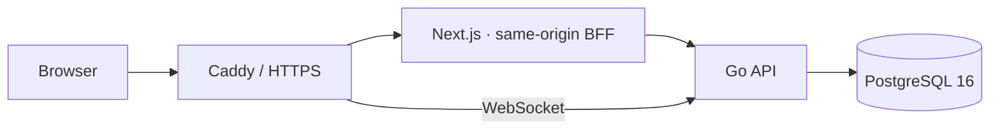

# Trickreport

**Trickreport** is a multi-tenant service platform. The first product being migrated is IT support; MSP and customer-service products have separate Next.js applications, with their backend and database isolation still pending.

## Current stack

- **API:** Go 1.26.10, chi, pgx, PostgreSQL 16.
- **Web:** Next.js 16 App Router, React 19, TypeScript, Tailwind CSS 4, HeroUI 3.
- **Runtime:** Node.js 24.22.1; npm workspaces share UI and API-boundary code.
- **Deployment:** Docker Compose, Caddy, PostgreSQL. The Astro application in `frontend/` remains as a migration reference; the active IT web app is `apps/it/`.



The browser talks to the Next.js same-origin proxy. Authentication tokens stay in HttpOnly cookies; auth JSON returned to the browser omits token fields. WebSocket upgrades go directly through Caddy to Go.

## Get started

For a fresh local setup, follow the [Spanish installation guide](docs/installation.md) or [English installation guide](docs/installation.en.md). The short version requires Node.js 24.22.1, Go 1.26.10, and PostgreSQL 16.15:

```sh
npm ci
cd backend && go run ./cmd/api
```

In another terminal, from the repository root:

```sh
npm run dev:it
```

The IT application opens at `http://localhost:3000`. The backend reads `backend/.env`; set its database URL, a strong JWT secret, bootstrap administrator, and `CORS_ORIGINS=http://localhost:3000` before starting.

For an on-premise Docker installation, configure `.env.onpremise` from `.env.onpremise.example`, then run:

```sh
docker compose --env-file .env.onpremise config --quiet
docker compose --env-file .env.onpremise up -d --build
```

## Useful commands

```sh
npm run lint
npm run check
npm test
npm run test:e2e
npm run build
cd backend && go test ./... -race
```

`make dev` starts the Go API and IT web app. Deployment, recovery and monitoring procedures are in [`docs/operations/`](docs/operations/). Brand colors and assets are in [`docs/brand/`](docs/brand/).

## Product and delivery status

The use-case catalog contains 200 proposed cases per product (600 total). Every catalog item is marked `planned`; none is evidence that the corresponding feature exists. See [`docs/use-cases/`](docs/use-cases/).

The IT app currently covers sign-in/MFA and recovery, profile, dashboard, tickets, comments, attachments, knowledge articles, SLA, user administration, automations, analytics and local drafts. The MSP and customer-service apps reuse the current workspace shell but do not yet have their own Go APIs, databases, or product-specific workflows. Production high availability and the 15,000-account / 1,500-concurrent-user targets have not been load-tested or demonstrated.
