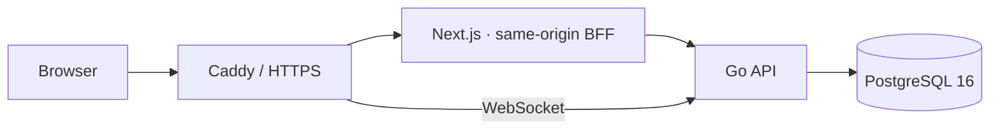

# Trickreport

**Trickreport** is a multi-tenant service platform. The first product being migrated is IT support; MSP and customer-service products have separate Next.js applications, with their backend and database isolation still pending.

## Features

Implemented today in the Go API and the IT support product:

- **Tickets:** create, assign, comment (public and internal notes), full change history, filters and CSV export.
- **Attachments:** strict content validation per format (magic bytes and container structure, not just the declared MIME type); script-bearing formats such as SVG are rejected.
- **SLA:** per-priority response/resolution/escalation deadlines persisted on each ticket, a background worker that escalates and notifies exactly once, and first-response/resolution metrics.
- **Automations:** tenant-scoped rules with canonical conditions and actions executed transactionally against tickets.
- **Knowledge base:** draft/publish workflow, categories, tags and role-aware visibility.
- **Identity:** JWT access/refresh pairs backed by persistent sessions with atomic rotation and revocation, TOTP MFA with single-use challenges, optional LDAP, and email password reset with single-use hashed tokens delivered through a durable PostgreSQL outbox.
- **Realtime:** WebSocket notifications targeted to authorized recipients per tenant — never tenant-wide broadcasts of private events.
- **Offline drafts:** browser drafts are scoped to the signed-in user and tenant; legacy unowned drafts stay quarantined instead of leaking into another account.
- **Administration and analytics:** user/role management, tenant-scoped KPIs, dashboards and exports.

## Current stack

- **API:** Go 1.26.10, chi, pgx, PostgreSQL 16.
- **Web:** Next.js 16 App Router, React 19, TypeScript, Tailwind CSS 4, HeroUI 3.
- **Runtime:** Node.js 24.22.1; npm workspaces share UI and API-boundary code.
- **Deployment:** Docker Compose, Caddy, PostgreSQL. The Astro application in `frontend/` remains as a migration reference; the active IT web app is `apps/it/`.



The browser talks to the Next.js same-origin proxy. Authentication tokens stay in HttpOnly cookies; auth JSON returned to the browser omits token fields. WebSocket upgrades go directly through Caddy to Go.

## Architecture

- **Backend (`backend/`):** a modular Go monolith organized as domain → application → infrastructure → HTTP interfaces, with manual wiring. PostgreSQL is the source of truth for data, sessions, background jobs and the email outbox. The existing API (`/api/v1`) is the IT support product's API; MSP and customer service will get their own compositions and databases.
- **Web apps (`apps/`):** three Next.js applications — `apps/it` (active), `apps/msp` and `apps/customer-service` (workspace shells) — sharing UI, translations, API contracts and utilities from `packages/` through npm workspaces.
- **Legacy frontend (`frontend/`):** the former Astro application, kept only as a migration reference. Its identity-scoped offline storage and security fixes remain maintained until the IT migration completes, then it is removed.
- **Database migrations:** embedded in the API binary and applied on startup (or via `--migrate-up` / `--migrate-down`). The current sequence is `000001`–`000011`: base schema, ticket escalation, notifications, then the stabilization series — session security (`000005`), MFA challenges (`000006`), password-reset security (`000007`), ticket idempotency (`000008`), SLA tracking (`000009`), email outbox (`000010`) and user session revocation (`000011`).

## Get started

For a fresh local setup, follow the [Spanish installation guide](docs/installation.md) or [English installation guide](docs/installation.en.md). The short version requires Node.js 24.22.1, Go 1.26.10, and PostgreSQL 16.15:

```sh
npm ci
cd backend && go run ./cmd/api
```

In another terminal, from the repository root:

```sh
npm run dev:it
```

The IT application opens at `http://localhost:3000`. The backend reads `backend/.env`; set its database URL, a strong JWT secret, bootstrap administrator, and `CORS_ORIGINS=http://localhost:3000` before starting.

For an on-premise Docker installation, configure `.env.onpremise` from `.env.onpremise.example`, then run:

```sh
docker compose --env-file .env.onpremise config --quiet
docker compose --env-file .env.onpremise up -d --build
```

## Useful commands

```sh
npm run lint
npm run check
npm test
npm run test:e2e
npm run build
cd backend && go test ./... -race
```

`make dev` starts the Go API and IT web app. Deployment, recovery and monitoring procedures are in [`docs/operations/`](docs/operations/). Brand colors and assets are in [`docs/brand/`](docs/brand/).

## Product and delivery status

The use-case catalog contains 200 proposed cases per product (600 total). Every catalog item is marked `planned`; none is evidence that the corresponding feature exists. See [`docs/use-cases/`](docs/use-cases/).

The IT app currently covers sign-in/MFA and recovery, profile, dashboard, tickets, comments, attachments, knowledge articles, SLA, user administration, automations, analytics and local drafts. The MSP and customer-service apps reuse the current workspace shell but do not yet have their own Go APIs, databases, or product-specific workflows. Production high availability and the 15,000-account / 1,500-concurrent-user targets have not been load-tested or demonstrated.
